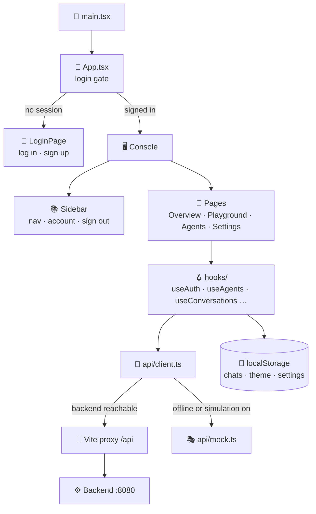
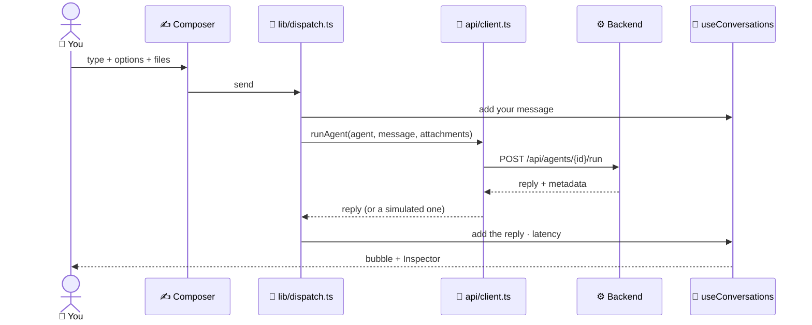
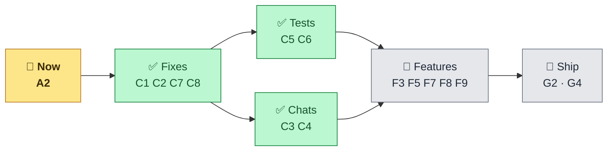

<div align="center">


# 🖥️ Frontend — Work Done & Remaining

**The React console: what is built, step by step, and what is left — cut into small pieces.**

[](Frontend/package.json)
[](Frontend/tsconfig.app.json)
[](Frontend/vite.config.ts)
[](#-at-a-glance)
[](#-checks)
[](#-checks)

</div>

> 📅 Checked against the code on **10 October 2026**. The backend side is in
> [`BACKEND_STATUS.md`](BACKEND_STATUS.md); the whole project's to-do list is in [`TASKS.md`](TASKS.md#-to-do-list) —
> the IDs below (**C1**, **F3**…) are the same.

---

## 🧭 At a glance

| | |
|---|---|
| 🧱 **Built with** | React 19 · TypeScript 6 (strict) · Vite 8 — **no UI kit, no state library, no router library** |
| 📄 **Pages** | 🔐 Login / sign-up · 🏠 Overview · 💬 Playground · 🤖 Agents · ⚙️ Settings |
| 🔌 **Talks to** | The Spring Boot backend through Vite's `/api` proxy — or a built-in **simulation** when it can't |
| 💾 **Keeps in the browser** | Chats, theme, settings (`localStorage`, keys starting with `maap.`) |
| ✅ **Done** | 12 steps — everything below in [Work done](#-work-done--step-by-step) |
| 🧩 **Left** | 8 small pieces — see [Remaining work](#-remaining-work--small-pieces) |
| 💾 **Git** | 🟢 Everything pushed — latest: E1 invite code field (`0c280f8`) |

---

## 🏗️ How the frontend is built



How one message travels:



---

## ✅ Work done — step by step

### 📦 Step 1 — Scaffold *(Sep 18)*

- ✅ Vite + React 19 + TypeScript project in `Frontend/`
- ✅ TypeScript **strict mode** on (`1ee37b4`, `dd41c1c`)
- ✅ ESLint with the React 19 hooks rules

### 🧱 Step 2 — Foundation *(Sep 19)*

- ✅ First components, hooks and pure-logic libraries (`lib/`) kept separate from the UI
- ✅ Four pages — Overview, Playground, Agents, Settings
- ✅ Sidebar + **hash routing** (`#/`, `#/playground/{id}`, `#/agents`, `#/settings`) without a router library

### 🔌 Step 3 — Wired to a backend *(Sep 19–20)*

- ✅ `types.ts` mirrors the backend's JSON exactly (`AgentInfo`, `AgentRequest`, `PlatformStatus`, …)
- ✅ Design tokens: **dark and light theme**
- ✅ `api/client.ts` — one `fetch` wrapper; every error read as RFC 9457 problem+json
- ✅ **Simulation mode** (`api/mock.ts`): with no backend, five fake agents answer, clearly tagged *simulated*
- ✅ Vite proxy: the browser only ever talks to `localhost:5173`, so no CORS

### 💬 Step 4 — The Playground *(Sep 20)*

- ✅ **Per-agent chat lists**; switching agent opens a fresh chat
- ✅ **Edit & resend**: change a sent message, the old reply is dropped, the agent answers again
- ✅ **Inspector**: latency, provider, model, metadata and the exact request
- ✅ **Per-agent colour**, contrast-checked
- ✅ Wide reply bubbles; code blocks with a **language chip and copy button** (own small markdown renderer)
- ✅ Coding Agent: a real **21-language dropdown**; options for every agent built from what the agent describes
- ✅ The sidebar **auto-collapses** in the Playground; responsive down to 320 px phones

### 📎 Step 5 — File attachments *(Sep 20)*

- ✅ Paperclip, **drag & drop** and **paste** to attach — for every agent
- ✅ Each file uploads at once; only its id travels with messages; files stay in context for the whole chat
- ✅ A file chip on the message that carried it

### 🚪 Step 6 — Login landing page *(Sep 22)*

- ✅ A full front page: hero with the form, About, Features, Contact
- ✅ Sticky nav that turns solid on scroll, mobile burger menu, shared dark/light theme
- ✅ *Remember me* for the username; show/hide password
- ✅ Scroll-jank fix: the blurred background is its own compositor layer

### 🔐 Step 7 — Real login *(Oct 10, `8e9f564`)*

- ✅ `hooks/useAuth.ts` — checks `GET /api/auth/me` once on load, so **a refresh keeps you signed in**
- ✅ `App.tsx` is a **gate**: the console doesn't mount (and sends nothing) until there is a session
- ✅ A `401` from **any** call sends you back to the login page
- ✅ Sidebar **account row + Sign out**; name hidden on phones
- ✅ Clear message when the backend can't be reached; *"Enter your username and password"* wording

### 🔁 Step 8 — Provider chain in Settings *(Oct 10)*

- ✅ Settings lists the backend's **failover order**, skipped providers greyed out with the key they need
- ✅ The Inspector names the provider that actually answered (`metadata.provider`)

### 📝 Step 9 — Sign-up form *(Oct 10, `087a3e6`)*

- ✅ The login page switches between **Log in** and **Create your account**
- ✅ The sign-up rules shown as a hint, and checked **before** sending (3–50 chars `A–Z a–z 0–9 . _ -`; 8+ char password)
- ✅ `autocomplete="new-password"` in sign-up mode; the old "no self-service sign-up" notice is gone
- ✅ `signup()` in `api/client.ts` and `useAuth` — you are signed in straight after

### 🧪 Step 10 — First tests *(Oct 11)*

- ✅ **Vitest** set up — `npm test` runs 56 tests in under a second, no backend or browser needed
- ✅ `lib/`: formatting, agent options, colours (readable contrast), storage that never throws, the send/edit flow
- ✅ `api/client.ts`: offline fallback, Simulation mode, a `401` → login page, error messages, uploads, a bad saved API address
- ✅ Proved useful: 2 bugs found and fixed on the way; 7 deliberate breaks of `client.ts` all caught

### ✏️ Step 11 — Edits rewind the server's memory *(Oct 13, `bdfeb18`)*

- ✅ Editing an earlier message makes the server forget that turn and the ones after it, then resends
- ✅ `serverTurnsFrom()` counts only turns a real backend reply answered (not errors, not simulated replies)
- ✅ `rewindConversation()` in `api/client.ts` — best effort: if it fails, the edit still goes out

### 💬 Step 12 — Chats per account *(Oct 13, `af776c7` · `1c7c3a0`)*

- ✅ Chats are saved under `maap.conversations.<username>`, so two people on one browser each see only their own
- ✅ The console is keyed by username: signing in as someone else always starts it fresh
- ✅ Chats saved before this move to the first account that signs in
- ✅ `source-map-js` updated (C8): `npm audit` finds 0 vulnerabilities
- ⚠️ This keeps chats apart in the console only — the browser's dev tools still show every account's chats

---

## 📁 What's where

```text
Frontend/src/
├── main.tsx               🚀 starts React (StrictMode)
├── App.tsx                🔐 login gate + the console shell + banners
├── types.ts               🧾 the JSON shapes shared with the backend
├── api/
│   ├── client.ts          🔌 every backend call · auth · offline fallback · problem+json errors
│   └── mock.ts            🎭 simulated agents, replies and uploads
├── pages/
│   ├── LoginPage.tsx      🚪 landing page + log in / sign up form
│   ├── OverviewPage.tsx   🏠 getting-started checklist, stats, recent chats
│   ├── PlaygroundPage.tsx 💬 chat list · thread · composer · Inspector
│   ├── AgentsPage.tsx     🤖 a card per agent, built from its description
│   └── SettingsPage.tsx   ⚙️ API address, simulation mode, theme, provider chain, delete chats
├── components/            🧩 Composer · MessageBubble · Markdown · Inspector · Sidebar · Icons · …
├── hooks/                 🪝 useAuth · useAgents · useConversations · useAttachments · useTheme · useHashRoute · …
├── lib/                   🧠 dispatch (send/edit flow) · storage · agentColor · attributes · util
└── test/                  🧪 fakes.ts — stand-ins for the tests · each `*.test.ts` sits next to its code
```

### 🔌 What the frontend calls

| | Call | Used for |
|---|---|---|
| 🔐 | `POST /api/auth/signup` · `/login` · `/logout` · `GET /api/auth/me` | Sign up, log in, log out, "am I signed in?" |
| 🤖 | `GET /api/agents` · `POST /api/agents/{id}/run` | Agent list (also the "Backend online" check) · send a message |
| ⚙️ | `GET /api/platform` | Provider chain, model, limits (Settings, Overview) |
| 📎 | `POST /api/documents` · `DELETE /api/documents/{id}` | Attach / remove a file |
| 🗑️ | `DELETE /api/conversations/{id}` | Forget a chat on the server when you delete it |
| ✏️ | `POST /api/conversations/{id}/rewind` | Forget the turns an edited message replaces |

### 🧪 Checks

| Check | Result |
|---|---|
| `npm run lint` (ESLint, React 19 rules) | 🟢 passing |
| `npm run build` (type-check + bundle) | 🟢 passing — ~308 kB JS, ~50 kB CSS |
| `npm test` (Vitest) | 🟢 71 passing in 7 files — `lib/`, `hooks/` and `api/client.ts`, no backend or browser needed |

> ⚠️ **Right now in your browser:** *Simulation mode* is on (`maap.simulate = true`), so replies are simulated even
> though the backend is up. Settings → turn *Simulation mode* off → *Apply & reconnect*. The two red `401`s on
> `/api/auth/me` in the console are normal ("not signed in yet"; twice because of React's dev mode).

---

## 🧩 Remaining work — small pieces

> **Size:** 🟢 under 30 min · 🟡 1–2 hours · 🔴 half a day &nbsp;·&nbsp; **Who:** 👤 you · 🤖 me (Claude) · 👥 together
> A 🟡 or 🔴 piece is split into numbered steps — each step is one small change you can check on its own.



### 🏁 Now

- [ ] **A2** 📝 Turn *Simulation mode* off, then sign up once in the browser; note any error in the
  [errors log](TASKS.md#-setup-errors-log) — 👤 🟢
- [x] **A3** 💾 Sign-up form committed and pushed (`087a3e6`) — 🤖 🟢

### 🖥️ C · Fixes

- [x] **C1** 🚪 A broken API address saved in the browser no longer locks you out (the login-page 404):
  `apiBase()` drops a saved value that fails `isValidApiBase` and uses `/api` — `api/client.ts` — 🤖 🟢
  **Checked in a real browser:** a pasted API key and `localhost:8080/api` → removed, login page loads,
  `/api/auth/me` answers `401` (not `404`) · a valid `/api/` is kept · 💾 `51f174b`
- [x] **C2** 🔑 The "no API key" hints name the key the backend reports (`platform.keyEnvVar`, the first
  provider in `AI_PROVIDERS`), not a fixed `GROQ_API_KEY` — `App.tsx` banner, `OverviewPage.tsx` step — 🤖 🟢
  **Checked in a real browser:** Gemini listed first → `GEMINI_API_KEY` in both · default order →
  `GROQ_API_KEY` · no key name sent → the sentence still reads, no empty code box · 💾 `9de624f`
- [x] **C7** 🎭 A simulated reply says *why*: *"Simulation mode is on in Settings"* when it was switched on,
  *"the backend could not be reached"* only when that is true (it always said offline) — `api/mock.ts`,
  `api/client.ts` — 🤖 🟢 · the mid-chat error no longer says *"Switched to simulation mode"* (the Settings
  switch stays off) · **Checked in a real browser:** simulation on → the Settings wording, no backend call ·
  backend down → the offline wording · backend drops mid-chat → error, simulated reply, then a real reply once
  it is back · 💾 `32494ce`
- [x] **C8** 🛡️ `npm audit`: `source-map-js` 1.2.1 → 1.2.2 (it comes with Vite → postcss; a crafted source map
  could hang the build tools) — 🤖 🟢 · done Oct 13 with `npm update source-map-js --before=2026-10-01`: the
  only package that changed · `npm audit`: **0 vulnerabilities** · tests, lint, build pass · 💾 `1c7c3a0`
- [x] **C3** ✏️ Editing an earlier message also rewinds the server's memory: the console asks
  `POST /api/conversations/{id}/rewind {turns}` to forget that turn and the ones after it, then resends —
  backend `ConversationRewind`, `lib/dispatch.ts`, `PlaygroundPage.tsx` — 🤖 🟡 · turns are counted **from the
  end** (still right once the 20-message window dropped the oldest), and only turns a real backend reply
  answered count · **Checked in a real browser:** three turns (41 · green · Paris), then the 2nd edited into "what did I ask you to remember?" → `rewind {turns: 2}` and the answer **41**; the same chat without the edit answers 41, green, Paris · 💾 `ee14263` `bdfeb18`
- [x] **C4** 💬 Chats belong to an account, not to the browser — 🤖 🟡 · 💾 `af776c7`
  1. ✅ `lib/storage.ts`: `conversationsKey(username)` → `maap.conversations.<username>`
  2. ✅ `useConversations(username)` loads and saves under it; the console is keyed by username in `App.tsx`
  3. ✅ One-time move: the old shared list goes to the first account that signs in, then is removed
  4. ✅ **Checked in a real browser** through the login form and Sign out: anna gets the old chat · ben sees none
     of anna's · anna again sees only hers
  5. ✅ The crash screen's "clear saved conversations" clears every account's chats, as its message says

### 🧪 C · Tests

- [x] **C5** 🧪 Vitest set up and the first tests, for `lib/` — 32 tests — 🤖 🟡 · 💾 `f480244` `7736878`
  1. ✅ `vitest` 5.0.2 as a dev dependency, installed with every package at least two weeks old · `npm test`
  2. ✅ No browser needed: the tests run in Node with small stand-ins (`src/test/fakes.ts`), so no jsdom yet
  3. ✅ `util`, `attributes`, `agentColor` (every chat colour keeps white text at 4.5:1), `storage` (never throws
     when blocked or full), `dispatch` (send, edit & resend, errors)
  4. 🐞 Found and fixed: a chat 45–59 s old said *"0m ago"*; 999.6 ms showed as *"1000 ms"*
- [x] **C6** 🧪 Tests for `api/client.ts` — 24 tests — 🤖 🟡 · 💾 `d8e4a57`
  1. ✅ A fake backend: answers by `METHOD url`; anything else fails like an unreachable server
  2. ✅ Offline → simulated agents, status `offline`, a re-probe on the next send · Simulation mode → no network call
  3. ✅ A `401` from any call tells the login gate (`useAuth` signs you out) · a `401` on `/auth/me` = not signed in
  4. ✅ problem+json `detail` → the message · an empty `502` → "could not be reached" · uploads keep the multipart header
  5. ✅ Checked that they catch bugs: 7 deliberate breaks in a copy of `client.ts`, each failed the test written for it

### 📚 Docs

- [x] **B6** 📝 `Frontend/README.md`: the old Spring Security note now explains sign-in; offline mode, prerequisites,
  API table and FAQ brought up to date — 🤖 🟢

### 🔒 Safe to share

- [x] **E1** 🎟️ *(UI half)* An **Invite code** field in sign-up mode (*"Only if you were given one"*), sent only when
  filled in; the backend's `403` message shows in the form — 🤖 🟢 · 💾 `0c280f8`
- [x] **E5** 🙈 No key in a `VITE_*` variable: no `.env` in `Frontend/`, only `VITE_API_BASE`, no key in the built
  bundle — 🤖 🟢

### 🌊 F · New features

- [ ] **F3** 🌊 Replies appear **word by word** — 🤖 🟡 *(after the backend's F1)*
  1. `api/client.ts`: `streamAgent()` reads the server-sent events
  2. `lib/dispatch.ts`: create the reply bubble at once, append text as it arrives
  3. A **Stop** button while it streams
  4. Fall back to `POST /run` when streaming isn't available, and in simulation mode
- [ ] **F5** 🧭 An **Auto** choice in the agent picker — the backend picks the agent *(after F4)* — 🤖 🟢
- [ ] **F7** 🔑 *(UI half)* *Forgot password* / change password form, replacing today's notice *(after the backend's F7)* — 🤖 🟢
- [ ] **F8** 🇬 *(UI half)* **Continue with Google** goes to the backend's Google sign-in, replacing today's notice *(after F8)* — 🤖 🟢
- [ ] **F9** 💰 **Token totals per chat** in the Inspector — 🤖 🟡
  1. Add up `metadata.tokens` of the chat's replies
  2. Show prompt / completion / total in the Inspector header

### 🐳 G · Ship it

- [ ] **G2** 🐳 Frontend `Dockerfile` — 🤖 🟡
  1. Stage 1: `node` image, `npm ci`, `npm run build`
  2. Stage 2: a small web server (e.g. nginx) serving `dist/`
  3. Its config forwards `/api` to the backend and sends unknown paths to `index.html`
- [ ] **G4** 🤖 *(frontend half)* CI runs `npm ci`, `npm run lint`, `npm run build` and `npm test` on every push — 🤖 🟢

> 🔒 **Still placeholders on the login page:** *Continue with Google* and *Forgot password?* answer with a short
> notice until **F8** and **F7**.

---

<div align="center">
<sub>🖥️ Frontend status · <a href="BACKEND_STATUS.md">BACKEND_STATUS.md</a> for the backend · <a href="TASKS.md">TASKS.md</a> for the whole to-do list · <a href="Frontend/README.md">Frontend/README.md</a> for how it works</sub>
</div>
