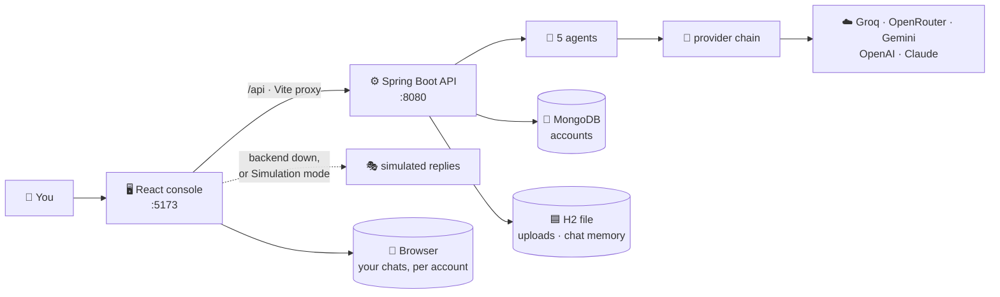

<div align="center">


# Multi-Agent AI Platform

**Five specialised AI agents, one console to talk to them.**

[](Backend/pom.xml)
[](Backend/pom.xml)
[](Backend/pom.xml)
[](Frontend/package.json)
[](Frontend/package.json)
[](DATABASE.md)
[](#-checks)

</div>

> [!NOTE]
> **Status (Oct 14, 2026):** backend and console work end to end — five real agents, five AI providers
> with failover, file attachments, sign-up and login. What's left, in small pieces: [`TASKS.md`](TASKS.md).

---

## ✨ What this is

A chat console for a team of focused AI agents — coding, research, summarising, document Q&A and
general chat. The big idea: **each agent describes itself** (name, options, capabilities), and the
console builds its cards, menus and controls from that description. Add an agent on the backend and
it appears in the console with no frontend changes.

| | Feature |
|---|---|
| 🔁 | **Five AI providers with failover** — Groq, OpenRouter, Gemini, OpenAI, Claude: when one fails, the next answers |
| 🔐 | **Sign up & log in** — accounts in MongoDB, passwords stored as hashes |
| 💬 | **Per-agent chats** — each agent keeps its own conversation list, saved per account |
| 📎 | **File attachments** — PDF, text and code files; every agent can read them for the whole chat |
| ✏️ | **Edit & resend** — change a sent message; the agent forgets what came after it |
| 🔍 | **Response Inspector** — latency, which provider answered, model, tokens and the exact request |
| 🎨 | **Per-agent colours** — you always know who you're talking to |
| 🎭 | **Simulation mode** — clearly tagged simulated replies when the backend drops, or when you switch it on |
| 🌗 | **Dark & light theme** · 📱 **responsive** from 320 px phones to wide screens |

---

## 🚀 Quick start

**You need:** ☕ Java 25 · 🟢 Node 20.19+ (or 22.12+) · 🍃 MongoDB running on this machine
([how](DATABASE.md)) · 🔑 a key for at least one AI provider — a free
[Gemini key](https://aistudio.google.com/apikey) is enough.

### 1️⃣ Backend

```powershell
cd Backend
copy .env.example .env        # macOS / Linux: cp .env.example .env
# open Backend/.env and paste your key after GEMINI_API_KEY=
.\mvnw spring-boot:run        # macOS / Linux: ./mvnw spring-boot:run
```

✅ Ready when the log says `Started MultiAgentAiPlatformApplication` and lists `AI providers, in failover order`.

### 2️⃣ Console — in a second terminal

```bash
cd Frontend
npm install
npm run dev
```

### 3️⃣ Sign up

Open <http://localhost:5173> → **Sign Up** → a username (3–50 letters, digits, `.` `_` `-`) and a
password (8+ characters). You're signed in straight away.

> 🔑 **Keys go only in `Backend/.env`** — git ignores that file. One key is enough; with more, they are
> tried in `AI_PROVIDERS` order and the next one answers when one fails. Settings shows the chain.

---

## 🧭 How it works



- 🔐 Every `/api` call needs a signed-in session, except sign-up, login and logout.
- 🧠 The server remembers the last 20 messages of each chat; your full chat history is kept in the browser.

---

## 🤖 The agents

| Agent | What it does | Options |
|---|---|---|
| 💻 **Coding Agent** | Working code first, then a short explanation | `language` — Auto-detect or one of 21 |
| 🔬 **Research Agent** | Summary, key findings, open questions, confidence | — |
| 📝 **Summarizer Agent** | Bullets, a TL;DR or an executive brief — of your text or an attached file | `style`, `maxWords` |
| 📄 **Document Agent** | Answers only from the files you attach | — |
| 💬 **General Assistant** | Everything else | — |

---

## 🗂️ Pages

| Route | Page | What's there |
|---|---|---|
| — | 🔐 Login | Log in or create an account — shown until you're signed in |
| `#/` | 🏠 Overview | Getting-started checklist, stats, how a request flows, recent chats |
| `#/playground` | 💬 Playground | Chat list · thread · composer · Inspector |
| `#/agents` | 🤖 Agents | A card for every agent, plus how to add one |
| `#/settings` | ⚙️ Settings | API address, Simulation mode, theme, AI provider chain, delete your chats |

---

## 📁 Project layout

```text
Multi-Agent-AI-Platform/
├── Backend/                 ⚙️ Spring Boot API (Java 25)
│   ├── src/main/java/…      agents · AI providers · documents · accounts · REST controllers
│   ├── src/main/resources/  application.properties · schema.sql
│   ├── .env.example         👉 copy to .env and add your keys (git ignores .env)
│   └── data/                H2 database file — created on first run, git-ignored
├── Frontend/                🖥️ React console — details in Frontend/README.md
│   └── src/                 api · pages · components · hooks · lib · types.ts
├── TASKS.md                 ✅ the to-do list: everything left, in small pieces
├── BACKEND_STATUS.md        ⚙️ backend — done and remaining
├── FRONTEND_STATUS.md       🖥️ frontend — done and remaining
├── DATABASE.md              🍃 accounts in MongoDB (or SQL), step by step
└── BACKEND.md               🗺️ how the backend was built, phase by phase
```

---

## 🔌 API

| Method | Path | Used for |
|---|---|---|
| `POST` | `/api/auth/signup` · `/login` · `/logout` | Create an account · sign in · sign out (no session needed) |
| `GET` | `/api/auth/me` | "Am I signed in?" — `401` when not |
| `GET` | `/api/agents` | The agent list — also the "Backend online" check |
| `POST` | `/api/agents/{id}/run` | Send a message |
| `POST` | `/api/agents/{id}/stream` | The same, the reply sent as it is written (server-sent events) |
| `GET` | `/api/platform` | Provider chain, model and limits (Settings) |
| `POST` · `DELETE` | `/api/documents` · `/api/documents/{id}` | Attach or remove a file |
| `DELETE` | `/api/conversations/{id}` | Forget a chat on the server |
| `POST` | `/api/conversations/{id}/rewind` | Forget the turns an edited message replaces |
| `GET` | `/actuator/health` | `{"status":"UP"}` |

Errors come back as `application/problem+json`; the console shows their `detail` text. JSON field
names match [`Frontend/src/types.ts`](Frontend/src/types.ts).

---

## 🧪 Checks

```bash
cd Backend
.\mvnw test        # 176 tests — no AI key needed; MongoDB must be running

cd Frontend
npm test           # 71 tests — no backend needed
npm run lint
npm run build      # type-check + production bundle
```

---

## 🆘 Troubleshooting

| What you see | Why · what to do |
|---|---|
| 🍃 Backend stops after ~30 s: *Application run failed … Timed out while waiting for a server* | MongoDB isn't running. Start it (Windows: the **MongoDB** service), then start the backend again. |
| 🚪 Login page: *Could not reach the backend* | The backend isn't running — signing in always needs it. |
| 🎟️ Sign-up: *Sign-up needs a valid invite code* | This console has `SIGNUP_INVITE_CODE` set: ask whoever runs it for the code. |
| 🧱 *Too many attempts from this address* | 5 login or sign-up attempts a minute: wait the seconds it says. |
| 🟠 *Backend offline* banner, replies tagged **simulated** | The backend stopped while you were signed in. Start it, then click **Retry**. |
| 🎭 Replies say *Simulation mode is on* | You switched it on: Settings → turn **Simulation mode** off → **Apply & reconnect**. |
| ❗ *Set GEMINI_API_KEY in Backend/.env* | The key is missing or wrong. Fix `Backend/.env` and restart the backend. |
| ⏳ *rate-limiting or unavailable* · slow replies | The provider is busy. Wait, or add a second key so another provider can take over. The Inspector shows who answered. |
| 🔴 Two `401`s on `/api/auth/me` in the browser console | Normal: before you log in, the page asks "am I signed in?" (twice in dev mode). |
| 🔒 *Continue with Google*, *Forgot Password?* show a notice | Not built yet — to-dos F8 and F7. |
| 🗑️ Chats disappeared | They're saved in this browser, per account: sign in with the same account. Clearing site data removes them. |
| ⚠️ Settings: *Use a path such as /api or a full http(s):// URL* | The API address needs `http://` or `https://` — or leave it empty to use the proxy. |

---

## 🔒 Security notes

- 🔑 **A Gemini key is in the public git history** (`eebf0a8`). Revoke it in
  [Google AI Studio](https://aistudio.google.com/apikey) — to-do A1. Keys belong only in `Backend/.env`.
- 🏠 **The backend listens on `127.0.0.1` only.** Before others can reach it (`SERVER_ADDRESS=0.0.0.0`), set
  `SIGNUP_INVITE_CODE` in `Backend/.env` — otherwise anyone could sign up and spend your AI credits — and turn on HTTPS.
- 🔐 **HTTPS, two ways** (both off by default): behind an HTTPS reverse proxy, set `FORWARD_HEADERS_STRATEGY=native`;
  or let Spring Boot serve it with `SSL_ENABLED=true`, `SSL_KEY_STORE` (a PKCS12 file) and `SSL_KEY_STORE_PASSWORD`.
  Either way the session cookie becomes `Secure`.
- 🧱 **Login and sign-up are rate-limited:** 5 attempts a minute per address, then a `429`.
- 🔐 **Passwords** are stored as BCrypt hashes. The session cookie is `HttpOnly` and `SameSite=Strict`.
- 🙈 **Never put keys in the frontend.** Anything in a `VITE_*` variable is visible to every visitor.
- 💾 **Chats are stored unencrypted** in the browser's `localStorage`, one list per account — anyone
  with this browser's dev tools can read them.

---

## 📚 More docs

| Doc | What's in it |
|---|---|
| ✅ [`TASKS.md`](TASKS.md) | Where things stand and everything left to do, in small pieces |
| ⚙️ [`BACKEND_STATUS.md`](BACKEND_STATUS.md) · 🖥️ [`FRONTEND_STATUS.md`](FRONTEND_STATUS.md) | Work done, step by step, and work remaining — per side |
| 🍃 [`DATABASE.md`](DATABASE.md) | How accounts are stored in MongoDB (or a SQL database), step by step |
| 🗺️ [`BACKEND.md`](BACKEND.md) | How the backend was built from an empty folder, phase by phase |
| 🖥️ [`Frontend/README.md`](Frontend/README.md) | How the console works inside |

---

<div align="center">
<sub>Built with Java 25 · Spring Boot 4.1 · Spring AI 2.0 · MongoDB &nbsp;·&nbsp; React 19 · TypeScript 6 · Vite 8</sub>
</div>
